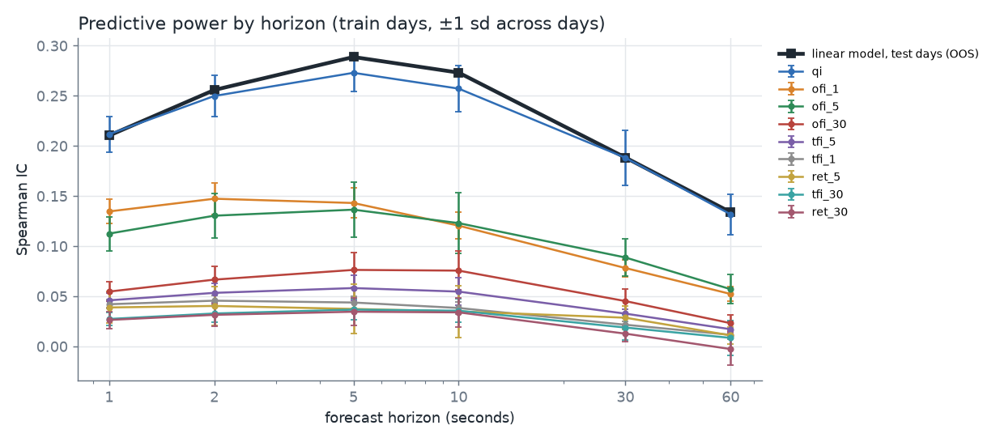
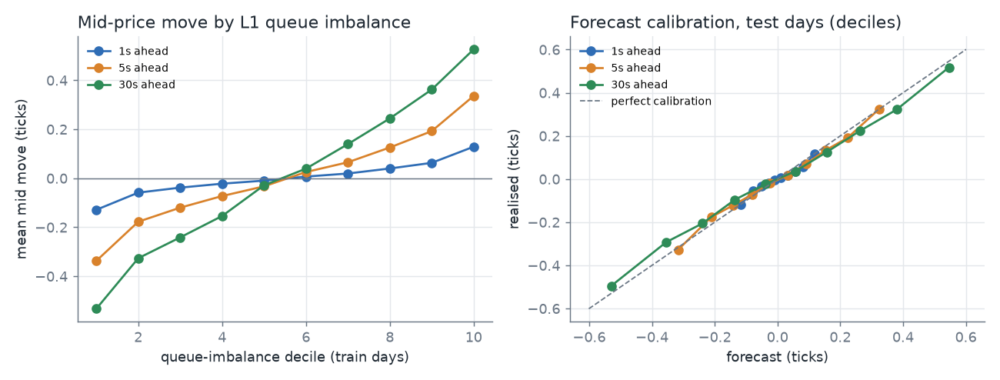
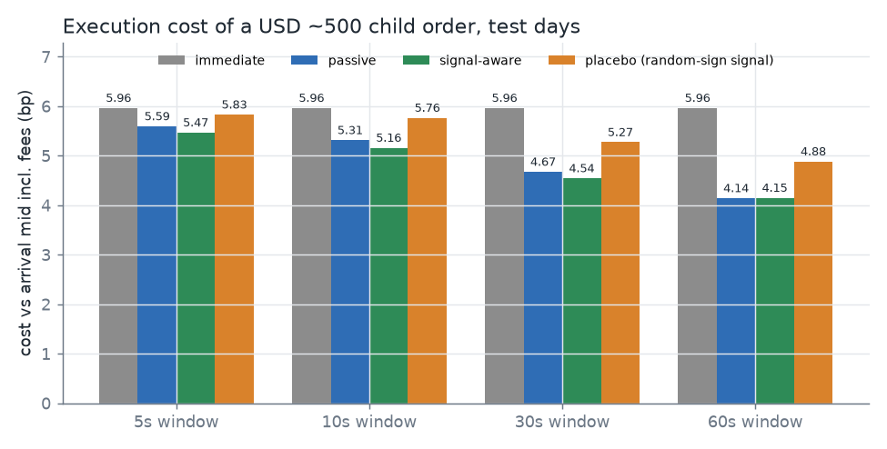
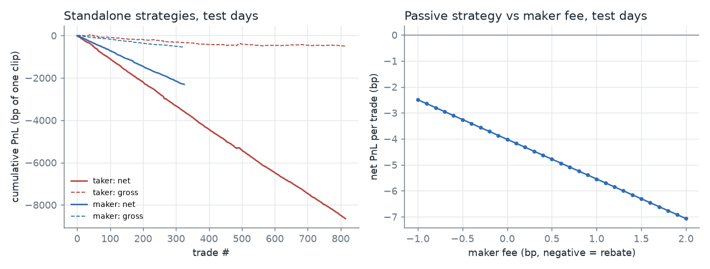

# Order-flow alpha and a tick-level execution backtester

Short-horizon price prediction from limit-order-book data, tested against a tick-by-tick
replay of the exchange with latency, queue position and fees. The question is not only
*"does the signal predict?"* but *"does it survive execution, and where is it actually useful?"*

**Data.** Binance USD-M perpetual **XRPUSDT**, 1 to 10 Feb 2024: **30.5M best-bid/ask updates**
and **1.12M trades** (USD 3.6bn traded), from Binance's public archive. XRP traded at
USD 0.49 to 0.53, so one tick (0.0001) is about **2 bp**, and the spread was one tick essentially
all the time, with roughly 80 to 110k contracts at the touch. That makes it a large-tick
contract, where queue dynamics drive short-term prices.

**Protocol.** Train on 1 to 5 Feb (model fit), validate on 6 to 7 Feb (every parameter choice),
and test on 8 to 10 Feb. The test days are run once, after every choice is frozen.

## Headline results (test days, out of sample)

| | Result |
|---|---|
| Signal | L1 queue imbalance has a Spearman IC of **0.28** with the 5-second mid move, stable from train (0.273) to validation (0.283) to test (0.284). |
| Forecast | A linear model of 9 order-flow features, fitted on train days only, reaches test **IC 0.29** and **out-of-sample R² 5.5%** at 5 s, with a near-diagonal decile calibration. |
| Standalone taker | **−10.6 bp per round trip** (815 trades). Gross is only −0.56 bp: the forecast offsets most of the ~2 bp spread, but not the 10 bp of taker fees. |
| Standalone maker | **−6.9 bp per round trip** (326 trades), with gross −1.55 bp from adverse selection. It is still −2.5 bp even with a 1 bp maker rebate. |
| **Execution overlay** | Over 25,875 parent orders, signal-aware passive execution cuts **slippage by 32%** compared with plain passive execution (1.06 → 0.72 bp, 30 s window). It lowers total cost by **0.13–0.15 bp** for 5–30 s windows (t = −8 to −18), and by **1.4 bp (−24%)** compared with market orders. |
| Placebo | The same policy with a random-sign signal makes cost worse by **+0.24 to +0.74 bp**, so the gain comes from the signal's direction, not from the timing mechanics. |
| Latency | The overlay's saving decays from 0.15 bp at 10 ms to 0.05 bp at 500 ms, as expected for an alpha with a half-life of seconds. |
| Engine | A numba event loop replays **4.0M events per day in 27 ms on one core** (~150M events/s). It ran the 936-backtest validation sweep in 17 s, and 14 unit tests pin down the matching rules. |

**Conclusion.** The order-flow signal is real and robust, but its edge (≤ 0.5 tick) is smaller
than the 1-tick spread. As a standalone strategy it loses money at any realistic fee level. Its
value is in **execution**: deciding when to wait in the queue and when to cross. That is the
same use that institutional execution desks make of microstructure signals.






Full tables: [results/RESULTS.md](results/RESULTS.md).

## Method

### Features (point-in-time, 100 ms clock, 8.6M samples)
| Feature | Definition |
|---|---|
| `qi` | L1 queue imbalance `(bid_qty − ask_qty) / (bid_qty + ask_qty)` |
| `ofi_w` | Order-flow imbalance (Cont, Kukanov & Stoikov, 2014) summed over the last w ∈ {1, 5, 30} s, scaled by current L1 depth |
| `tfi_w` | Signed aggressor volume / total volume over the last w s |
| `ret_w` | Mid-price change over the last 5 / 30 s, in ticks |

The targets are forward mid changes in ticks at 1, 2, 5, 10, 30 and 60 s. Every feature at time *t*
uses only data stamped at or before *t*. The standardisation statistics come from the train days only.

### Matching engine ([`ofalpha/engine.py`](ofalpha/engine.py))
- **Event replay:** quotes, trades, decisions and the strategy's own order actions (activation,
  cancellation, market orders) are merged in time order. Each order action takes effect after
  a configurable latency.
- **Taker fills:** the touch price at arrival, plus one extra tick on any size beyond the
  displayed quantity.
- **Passive fills:** a queue-position model. We join behind the displayed size. The queue ahead
  shrinks only through trades at our price, or when the displayed size falls below our position
  ("risk-averse" assumption: cancellations come from behind us). We are filled when trade volume
  at our price clears the queue ahead plus our own size, on a trade-through, or when the opposite
  quote reaches our price.
- **Fees:** Binance VIP 0 (maker 2 bp, taker 5 bp). The execution study re-prices the same fills
  under other fee tiers.

### Strategies and execution study
- **Taker:** cross when |forecast| > θ ticks, hold for h seconds, cross back.
  Grid: 6 θ × 6 h × 3 latencies.
- **Maker:** join the touch on the forecast side, exit passively one spread away, with
  time, price and signal-flip stops. Grid: 360 configurations.
- **Execution overlay:** a 1,000-contract parent order arrives every 10 s with a random side and
  must finish within W ∈ {5, 10, 30, 60} s. The three policies are *immediate*, *passive then
  cross at the deadline*, and *signal-aware* (cross at once, or early, when the forecast says the
  price is about to move away). Cost is measured against the arrival mid, fees included. The
  paired differences use standard errors from 5-minute blocks, because the windows overlap.

## Limitations
- One symbol, 10 days, one market regime. The test period is 3 days (about 26k parent orders),
  enough for the execution comparisons but not for strategy-level Sharpe ratios.
- Level-1 data only, so queue position is modelled rather than observed, and deeper levels are
  unseen. The risk-averse queue rule is a deliberately conservative choice.
- Our own orders are assumed not to move the market. That is reasonable for 1,000-contract
  clips against ~90k at the touch, but not for size.
- Quote and trade streams are aligned at millisecond resolution, with trades processed first on ties.
- The fee tiers other than VIP 0 are approximate.

## Reproduce
```bash
python -m venv .venv && .venv/Scripts/activate      # Windows; use bin/activate elsewhere
pip install -r requirements.txt
python -m pytest -q tests                            # 14 matching-engine tests
python run_all.py                                    # ~550 MB download, then ~7 min of compute
```

## Layout
```
ofalpha/config.py      symbol, dates, split, fees, grids
ofalpha/data.py        download + SHA-256 check + Parquet (prices as integer ticks)
ofalpha/features.py    point-in-time features and targets on a 100 ms clock
ofalpha/research.py    IC analysis, decile tables, OLS forecast, out-of-sample evaluation
ofalpha/engine.py      numba matching engine: taker, maker, execution overlay
ofalpha/sweep.py       parallel parameter sweep, validation selection, test run
ofalpha/execution.py   execution-cost study with placebo and latency checks
ofalpha/report.py      figures and results/RESULTS.md
tests/test_engine.py   hand-built order-book scenarios with known fills
```
